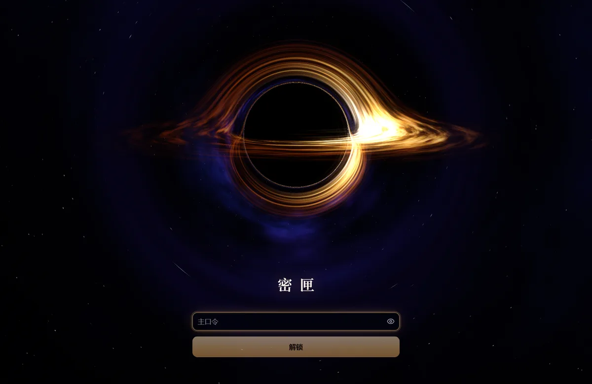
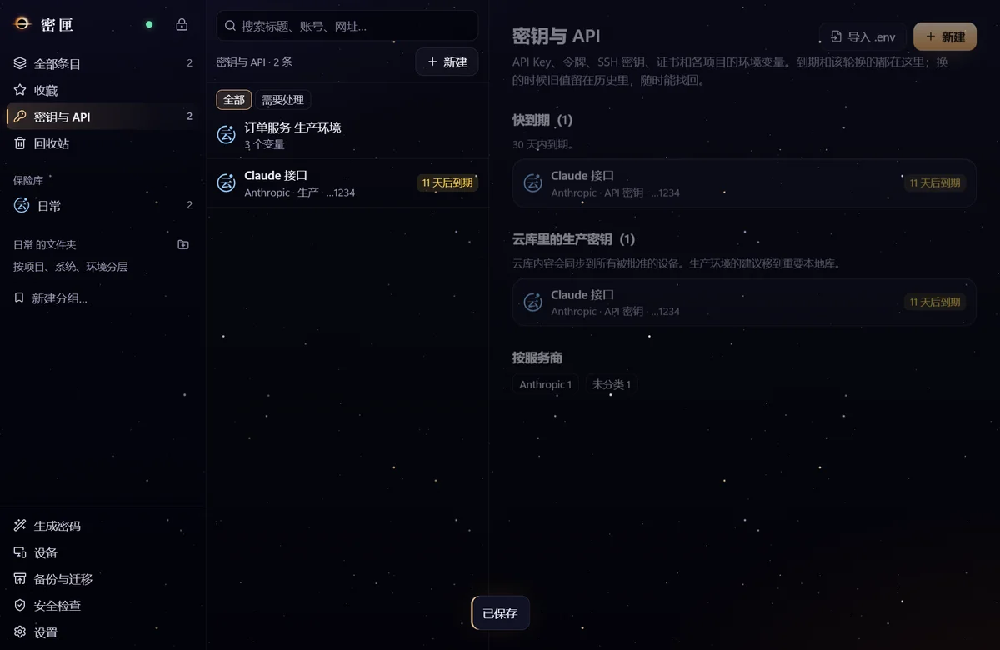

<div align="center">


# 密匣 Mixia

**把密码藏进黑洞：一个只属于你自己的端到端加密密码管理器。**

服务器只保存它读不懂的密文，只有你批准过的设备能打开，重要内容可以完全不上云。

[](https://github.com/Feianxc/mixia/actions/workflows/ci.yml)
[](LICENSE)
[](https://github.com/Feianxc/mixia/releases)

[使用手册](docs/使用手册.md) · [架构设计](docs/架构设计.md) · [协议规范](docs/协议规范.md) · [安全策略](SECURITY.md) · [English](#english)


</div>

## 它是什么

密匣是为**一个所有者、几台自有设备**设计的密码系统，包括 Windows 桌面端、Android 手机端、Chrome / Edge 扩展，
以及一个自己部署的 Go 同步服务端。它不做多人共享，不做网页版，也没有公开注册。

- **三类库，三种安全域。** 云同步日常库经服务器在授权设备间同步；重要本地库不上云，只在指定设备之间传；
  冷库是离线介质上的文件，日常设备不持有。界面统一，密钥、存储和传输权限彼此分开。
- **设备就是钥匙。** 每台设备的认证密钥放在 TPM（Windows）或 Android Keystore 里，不可导出。新设备必须由已批准的
  管理设备核对指纹后批准。只拿到主口令或者复制走数据目录，都打不开。
- **服务器不可信。** 服务端只存信任账本、密文变更日志、按设备封装的库密钥和加密附件。没有账户密码，没有会话，
  每个请求由设备密钥签名。它不提供任何网页，界面代码只来自本机安装包。
- **界面层没有联网能力。** 界面的 CSP 是 `connect-src 'none'`，只有平台外壳的传输桥能联网，本地库因此没有上云的路径。
- **不只是密码。** API Key、访问令牌、SSH 密钥、证书和环境变量组都是条目类型：粘贴即识别服务商，
  一键复制成 PowerShell / bash 的环境变量，按到期和轮换周期提醒。
- **填充要你点头。** Android 用系统自动填充服务；电脑上的浏览器扩展经 native messaging 连到桌面端，
  每次填充都在桌面窗口核对网址后确认。
- **能离开项目独立恢复。** 离线恢复工具不需要服务器和客户端，直接读备份文件。
- **星空黑洞界面。** 启动时穿过一个 Ellis 虫洞，落向远处的黑洞；黑洞按史瓦西度规逐像素积分光线，带多普勒增亮的吸积盘。
  全部是 WebGL 实时渲染，失焦和闲置时自动停画省电。

<table>
  <tr>
    <td width="50%"></td>
    <td width="50%"></td>
  </tr>
  <tr>
    <td align="center">锁屏</td>
    <td align="center">密钥与 API（测试数据）</td>
  </tr>
</table>

## 安全模型

| 场景 | 结果 |
|---|---|
| 服务器数据库被偷 | 只有密文、公钥和封装，没有可以离线爆破的口令派生物 |
| 服务器被完全控制 | 不能伪造设备或条目，不能解密。能拒绝服务、隐瞒最新数据，客户端检测到回退会告警并停止写入 |
| 主口令泄露 | 没有已批准设备的硬件就没用 |
| 复制设备数据目录 | 设备秘密解封不了，口令也打不开 |
| 设备被盗（已锁） | 需要口令；可以在别的设备上撤销它并换钥 |
| 恶意网页或 iframe 想拿密码 | 拿不到（原理见架构设计第 10 节），每次填充还要在桌面确认 |
| 设备中了恶意软件且已解锁 | **防不住**，这是所有密码管理器的边界 |
| 全部设备和恢复码都丢失 | **无法恢复**，没有后门 |

服务器和被撤销设备串通、同用户恶意程序、备份文件可被伪造等**已知边界**都写在
[架构设计 · 已知边界](docs/架构设计.md#已知边界) 里。密码学原语全部来自成熟的库（libsodium、@noble），
协议是自己设计的，见 [协议规范](docs/协议规范.md)。

> [!WARNING]
> 密匣**没有经过第三方密码学审计**，也没有代码签名证书。开发中做过 AI 辅助的对抗式安全审查和变异测试，
> 结果和没有验证的部分都记在 [验收记录](docs/验收记录.md)。请先做一次恢复演练，再放入重要账号。

## 快速开始

1. **部署服务端。** 一台能跑 systemd 的 Linux 主机，经 Cloudflare Tunnel 或反向代理提供 HTTPS。
   步骤见 [部署与运维](docs/部署与运维.md#第一次部署)。
2. **安装客户端。** 在 [Releases](https://github.com/Feianxc/mixia/releases) 下载：

   | 文件 | 说明 |
   |---|---|
   | `Mixia-Setup-<版本>.exe` | Windows 11 安装包，需要 TPM 2.0，没有软件顶替（Windows 10 未测试） |
   | `Mixia-<版本>.apk` | Android 手机端 |
   | `Mixia-extension-<版本>.zip` | Chrome / Edge 扩展，解压后“加载已解压的扩展程序” |
   | `mixia-recover-<版本>.cjs` | 离线恢复工具，用 Node.js 运行 |

3. **第一次使用。** 在桌面端选“第一次使用”，填服务器地址和部署时生成的一次性令牌，设主口令，抄下恢复凭证。
   之后按 [使用手册](docs/使用手册.md) 添加手机、开自动填充、装浏览器扩展。

## 从源码构建

需要 Node.js 24、Go 1.27；Android 还要 JDK 21 和 Android SDK；桌面端只支持 Windows。

```bash
npm ci
npm -w @mixia/ui run build                       # 界面，桌面和手机共用
npm -w @mixia/desktop run dist                   # Windows 安装包，先构建两个 Go 助手，见部署文档
npm -w @mixia/extension run build                # 浏览器扩展
cd apps/mobile && npx cap sync android && cd android && ./gradlew assembleRelease
cd server && go build -o dist/mixia-server ./cmd/mixia-server
```

自己部署时可以在构建界面前设 `VITE_MIXIA_DEFAULT_SERVER=https://你的服务器`，新设备就不用再填地址。

## 测试

```bash
cd server && go build -o dist/mixia-server-test.exe ./cmd/mixia-server && cd ..
npm test                                         # 核心：单元测试 + 真实服务端端到端
npm -w @mixia/extension run test
cd server && go vet ./... && go test ./...
```

真实 Electron + TPM、真实浏览器、Android 真机和变异测试的跑法见 [部署与运维 · 测试](docs/部署与运维.md#测试)。

## 目录

```
packages/core/   共享核心：加解密、账本、库引擎、同步、Pack（含全部测试）
packages/ui/     React 界面，桌面和手机共用；cosmos/ 是黑洞和虫洞的 WebGL 场景
apps/desktop/    Electron 外壳；native/hwkey 是 TPM 助手，native/nmhost 是浏览器扩展的桥（都是 Go）
apps/extension/  Chrome / Edge MV3 扩展
apps/mobile/     Capacitor Android，Java 插件：Keystore、传输、自动填充
apps/cli/        离线恢复工具
server/          Go 同步服务端（SQLite）
deploy/          systemd 单元、备份脚本、环境变量模板
scripts/         字体和图标生成、变异测试
docs/            使用、架构、协议、部署、验收
研究报告/         立项时的架构设计与研究报告（PDF）
```

## 文档

| 文档 | 内容 |
|---|---|
| [使用手册](docs/使用手册.md) | 第一次使用、添加设备、三类库、密钥与 API、备份、设备丢失 |
| [架构设计](docs/架构设计.md) | 相对研究报告的调整、密钥层次、能防什么和不能防什么 |
| [协议规范](docs/协议规范.md) | 账本、请求认证、同步、换钥、配对、Pack |
| [部署与运维](docs/部署与运维.md) | 部署、发布、备份恢复、构建、测试 |
| [验收记录](docs/验收记录.md) | 实际验证过什么、结果、没验证什么 |
| [研究报告](研究报告/个人密码系统架构设计与研究报告_v1.0.pdf) | 产品与开源方案研究、威胁模型、分阶段计划 |

## 参与

欢迎提 issue 和 PR，先看 [贡献指南](CONTRIBUTING.md)。**安全问题请不要公开提 issue**，按 [安全策略](SECURITY.md) 私下报告。

项目由个人维护，开发中使用了 AI 编程助手；涉及安全的改动都要求有测试，并用变异测试确认测试真的能发现问题。

## 许可证

[MIT](LICENSE)。随项目分发的字体使用 SIL Open Font License 1.1，第三方组件见 [THIRD_PARTY_NOTICES](THIRD_PARTY_NOTICES.md)。

---

## English

**Mixia (密匣, "secret casket")** is a self-hosted, end-to-end encrypted password manager for a single owner and a
handful of personal devices: a Windows desktop app (Electron + TPM), an Android app (Capacitor + Android Keystore),
a Chrome / Edge extension, and a small Go sync server that only ever sees ciphertext.

- **Three vault tiers**: cloud-synced vaults, device-local vaults that never touch the server, and offline cold vaults.
- **Devices are the keys**: per-device hardware-bound keys; new devices must be approved by an admin device after a
  fingerprint check. A leaked master password or a copied data folder is not enough.
- **Untrusted server**: it stores a signed trust ledger, encrypted change logs, per-device wrapped vault keys and
  encrypted blobs. No accounts, no passwords, no sessions; every request is signed by a device key.
- **No network in the UI layer** (`connect-src 'none'`); only the platform shell can talk to the server.
- **API keys and secrets** are first-class items with provider detection and one-click export as environment variables.
- **A black-hole UI**: a real-time WebGL Ellis wormhole and Schwarzschild black hole with a Doppler-beamed accretion disk.

The UI and documentation are in Simplified Chinese. Mixia has **not** been audited by a third party; read
[SECURITY.md](SECURITY.md) and the known limitations in [docs/架构设计.md](docs/架构设计.md#已知边界) before trusting it
with important accounts. Licensed under [MIT](LICENSE).
